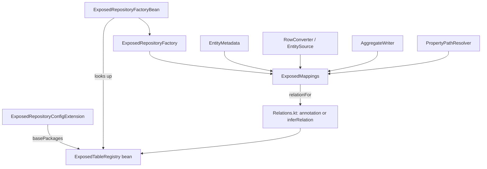

# Requirements

### Overview & Goals
Infer to-many relations (back references) of aggregates automatically from the foreign keys of all known tables, so that `@ExposedReferencedBy` is only needed to override a relation or to resolve an ambiguous one. Inferred relations behave exactly like annotated ones for reading, saving and derived queries, at any depth. The feature is still unreleased, so breaking changes are fine. Every stage is done test-first: write the failing tests, then implement until they pass.

### Scope
**In scope**
- A table registry fed by scanning the `@EnableExposedRepositories` base packages, plus an explicit list for factories built without Spring.
- Inference of owned (one-to-many) and join (many-to-many) relations for unannotated collection properties.
- Fail-fast errors on ambiguity. They list the candidates and say whether `column` or `target` is needed.
- `@ExposedReferencedBy` becomes an override only.
- Deleting a parent no longer deletes its children in the application (`deleteOwned`). That job moves to the FK `onDelete` rule. Orphan removal on save stays.
- Deep derived queries through inferred relations (`findByOrdersItemsArticle`) and `IsEmpty`/`IsNotEmpty` on to-many paths.
- A separate, standalone Markdown document (`SPRING_DATA_EXPOSED_SEMANTICS.md`) that describes the complete derived-query and persistence/cascade semantics, with GitHub-rendered Mermaid flowcharts and examples per use case, ready to copy and paste.

**Out of scope**
- Count comparisons in derived queries (use `@Query`/`Op` instead).
- Changing the to-one save cascade (`AggregateWriter.cascade`).
- Native-image / AOT generation of the table list (scanned tables are not pre-registered at AOT time yet).
- Guarding against owned rows that also have their own repository. This is deliberately allowed.

### User Stories
- As a developer, I want `data class Shop(val orders: List<Order>)` to just work when `ShopOrders.shop` references `Shops`, without any annotation.
- As a developer, I want a clear error when creating the repository if a collection could map to several foreign keys or join targets, telling me exactly what to annotate.
- As a developer, I want `findByOrdersItemsArticle("Pen")` to filter through `Shop → orders → items`.
- As a developer, I want deletes to follow my schema's `ON DELETE` rules instead of hidden application-side cascades.
- As the maintainer, I want one self-contained Markdown document with flowcharts and examples that explains how relations are resolved, how saves and deletes cascade, and how derived queries are built, so I can copy it into docs or a PR.

### Functional Requirements
- Inference applies to a persistent property that is a `List`/`Set`/`Collection`/`Iterable` of a non-simple element type `E`, has no column of its own and no `@ExposedReferencedBy`.
- **Owned candidate:** a registered table `T` with a single-column FK to the owner table, where every non-collection property of `E` resolves to a column of `T`.
- **Join candidate:** a table `T` with a single-column FK to the owner table, plus exactly one other single-column FK whose target table `E` fits. That other FK is the `target`.
- Exactly one candidate means the relation is resolved: an `OwnedRelation` or `JoinRelation`, the same classes as today.
  - **No candidate:** repository creation fails and the message suggests `@ExposedReferencedBy`.
  - **Several candidates:** repository creation fails, listing each candidate as `Table.column` (and `target`) and naming the missing attribute.
- An annotated property always uses the annotation, ignoring inference.
- **Saving:** owned collections are synced as today (insert, update, orphan removal). Join relations stay read-only.
- **Deleting:** `deleteById`, `delete`, `deleteAll*` and derived `deleteBy` delete only the parent rows. Children follow the FK `onDelete` (`CASCADE` deletes them, `RESTRICT` makes the delete fail).
- Derived queries resolve inferred relations at every hop. Parts with the same prefix keep sharing one subquery.
- `IsEmpty`/`IsNotEmpty` on a to-many path compile to `[NOT] IN (subquery)`. On scalar properties they stay unsupported.

### Non-Functional Requirements
- The registry is built once per application context, and the reverse-FK index is cached. Tables are compared by identity.
- Existing tests in `exposed-spring-data` keep passing, or are updated where the semantics change on purpose (delete cascade, unsupported part types).

# Technical Design

### Current Implementation
- `mapping/Relations.kt#toManyRelation(owner, annotation, property, where)` turns `@ExposedReferencedBy` into `OwnedRelation`/`JoinRelation`. Its callers each read the annotation themselves:
  - `EntityMetadata.columnsByProperty` (excludes annotated properties)
  - `RowConverter.kt#readerFor` / `EntitySource`
  - `AggregateWriter.columns` / `collections`
  - `query/PropertyPathResolver` hops
- `AggregateWriter.deleteOwned`/`ownsRows` delete children before the parent. They are called from `SimpleExposedRepository` (delete methods), `PartTreeExposedQuery` (derived delete) and `AggregateWriter.syncByKey`/`syncByValues` (grandchildren of removed rows).
- `ExposedRepositoryConfigExtension.registerBeansForRoot` registers the shared `ExposedMappingContext`. `ExposedRepositoryFactoryBean` looks it up and passes it to `ExposedRepositoryFactory`, which builds `ExposedMappings` lazily.

### Key Decisions
- **Where tables come from:** the `@EnableExposedRepositories` base packages are scanned once into a shared root bean (chosen by the user). A hand-built `ExposedRepositoryFactory` gets an explicit `ExposedTableRegistry` and defaults to an empty one.
- **Same semantics as the annotation:** inference produces the existing relation classes, so the read, write and query code doesn't need to know where a relation came from.
- **No application-side delete cascade:** remove `deleteOwned`. The database FK rule is the single source of truth. Orphan removal stays because the FK can't express it.
- **No name heuristics:** inference is structural only (FK + element type fit). Ambiguity is an error.

### Proposed Changes
1. **`ExposedTableRegistry`** (new, `mapping/`)
   - Holds the `Table` objects.
   - Builds an identity-keyed index `incoming(table): List<ForeignKeyConstraint>`, single-column only. This is the reverse counterpart of `TableDepthGraph`.
   - `scan(basePackages)` uses `ClassPathScanningCandidateComponentProvider` (with `isCandidateComponent` overridden to accept nested and abstract-less objects) plus an `AssignableTypeFilter(Table::class.java)`, reading each object via `kotlin.objectInstance`.
2. **Spring wiring**
   - `ExposedRepositoryConfigExtension.registerBeansForRoot` registers bean `exposedTableRegistry` with the `configurationSource.basePackages`, unless one already exists.
   - `ExposedRepositoryFactoryBean` resolves it like the mapping context.
   - `ExposedRepositoryFactory(tables = …)` passes it to `ExposedMappings(tables = …)`.
3. **Inference** in `Relations.kt`: `inferRelation(owner, ownerType, property, elementType, registry, where): ToManyRelation?`, using the candidate rules from Requirements. `ExposedMappings.relationFor(owner, type, property)` caches annotation-or-inferred results per (owner identity, type, property).
4. **Call sites:** `EntityMetadata` gets `relations: Map<String, ToManyRelation>` and excludes those properties from `columnsByProperty`. `RowConverter`/`EntitySource`, `AggregateWriter` and `PropertyPathResolver` call `mappings.relationFor(...)` instead of `propertyAnnotation<ExposedReferencedBy>`.
5. **Delete:**
   - Remove `AggregateWriter.deleteOwned`/`ownsRows` and their calls in `SimpleExposedRepository` and `PartTreeExposedQuery`.
   - Orphan removal in `syncByKey`/`syncByValues` keeps only `table.deleteWhere`.
6. **Queries:** add `IS_EMPTY`/`IS_NOT_EMPTY` to `SUPPORTED` in `ExposedQueryCreator`, valid only when the path ends on a to-many hop. Build them as `parentKey [NOT] inSubQuery child.select(fk)`, reusing the existing hop/`combine` machinery.
7. **Docs:** update the KDoc of `ExposedReferencedBy` and `AggregateWriter`, and `SPRING_DATA_EXPOSED_INTEGRATION.md`, to describe inference, overrides and the `onDelete` rule.
8. **Semantics document** (new, `SPRING_DATA_EXPOSED_SEMANTICS.md` in the project root, next to `SPRING_DATA_EXPOSED_INTEGRATION.md`):
   - Self-contained: no links needed to understand it. Written in short plain technical English (`code-doc-writer` skill).
   - Charts are fenced ```` ```mermaid ```` `flowchart` blocks, which GitHub renders natively. Only basic syntax (nodes, edges, edge labels), so it also renders in other Mermaid viewers.
   - Every example is taken from, or checked against, a passing test in `exposed-spring-data` (`InferredRelationRepositoryTest`, `AggregateRepositoryTest`, `DerivedQueryJoinTest`), so the document matches the implemented behaviour. Generated SQL shown in examples is copied from `captureSelects` output.
   - Outline:
     1. **Concepts:** aggregate, to-one reference, owned relation, join relation, table registry.
     2. **Relation resolution:** flowchart *property → annotated? → collection? → candidates (owned/join) → 0 / 1 / n → error or relation*; table of error messages and the fix for each.
     3. **Reading:** how owned and join collections are loaded, nested aggregates.
     4. **Saving:** flowchart *save(entity) → to-one cascade upward → insert/update parent → sync owned collections (by PK or by value) → orphan removal*; join relations read-only.
     5. **Deleting:** flowchart *delete → parent rows only → DB `onDelete` (`CASCADE` / `SET NULL` / `RESTRICT`)*; table of `onDelete` rules and results; orphan removal vs. delete cascade.
     6. **Derived queries:** flowchart *method name → PartTree → PropertyPath → hops via relationFor → nested `IN` subqueries → shared prefix*; supported keywords incl. `IsEmpty`/`IsNotEmpty` on to-many paths; derived `deleteBy`; sorting limits.
     7. **Use-case examples** (Kotlin table + data class + repository + resulting behaviour/SQL): one-to-many, many-to-many via join table, self reference, nested aggregate (3 levels), ambiguous FK fixed with `column`, ambiguous join fixed with `target`, override with a different `target`, to-one upward cascade, `onDelete` variants, deep query with shared prefix, `IsEmpty`/`IsNotEmpty`.
     8. **Limits:** count comparisons, paths must exist in Kotlin types, tables outside base packages, native image.

### Data Models / Contracts
```kotlin
internal class ExposedTableRegistry(tables: Collection<Table>) {
    fun incoming(table: Table): List<ForeignKeyConstraint>   // single-column FKs targeting `table`, identity-based
    companion object {
        val EMPTY: ExposedTableRegistry
        fun scan(basePackages: Collection<String>, classLoader: ClassLoader?): ExposedTableRegistry
    }
}

internal fun inferRelation(
    owner: Table, ownerType: Class<*>, property: String, element: Class<*>,
    registry: ExposedTableRegistry, where: String,
): ToManyRelation?   // null = not a relation; throws IllegalArgumentException when ambiguous

// ExposedMappings
fun relationFor(owner: Table, type: Class<*>, property: String): ToManyRelation?
```
Example error:
> `Account.outgoing` is ambiguous: `transfers.from_id` and `transfers.to_id` both reference `accounts`. Annotate it with `@ExposedReferencedBy(Transfers::class, column = "...")`.

### Architecture Diagram


### Risks
- **Element-type fit is too loose** (a small DTO fits several tables). This is reported as ambiguity, and the user annotates.
- **The scan picks up all test tables in the package.** Inference only looks at the owner's incoming FKs, so unrelated tables don't matter. Add `onDelete` to the test fixtures where deletes are expected.
- **Delete behaviour now depends on the schema.** H2 enforces FKs; this is documented.
- **Classpath scanning in native images** isn't covered. `AotGeneratedContextTest` must still pass in JVM mode.

# Testing

### Validation Approach
Each stage starts by adding or changing tests that fail against the current code. Then production code is changed until `./gradlew :exposed-spring-data:test` passes. `./gradlew :exposed-spring-data:detekt` and `apiCheck` run at the end of each stage.

### Key Scenarios
- **Registry (`ExposedTableRegistryTest`, no Spring):**
  - `scan("org.jetbrains.exposed.v1.spring.data")` finds top-level and nested table objects.
  - `incoming(Purchases)` contains the FKs of `PurchaseLines`, `PurchaseNotes` and `PurchaseLabels`.
  - Identity is respected for two tables with the same name.
  - Multi-column FKs are ignored.
- **Inference (`InferredRelationRepositoryTest`, Spring context, new unannotated fixture):**
  - Fixture: `Shops ← ShopOrders ← ShopOrderItems`, plus the join `ShopOrderTags → Tags`, all with `onDelete = CASCADE`.
  - Loading the owned and join collections.
  - Saving syncs owned rows: insert, update and orphan removal.
  - Join rows aren't written.
- **Ambiguity and override (nested repositories via `ExposedRepositoryFactory(tables = …)`):**
  - `Transfers(from, to) → Accounts` fails, mentioning both columns and `column`.
  - A join table with two FKs to `Tags` fails, mentioning `target`.
  - The annotation with `column` resolves.
  - An unregistered child table fails, mentioning `@ExposedReferencedBy`.
- **Delete:**
  - Deleting a shop removes its orders and items through `CASCADE`.
  - A fixture without cascade makes `deleteById` throw an FK violation and leaves the rows in place.
- **Deep queries:**
  - `findByOrdersItemsArticle`.
  - `findByOrdersItemsArticleAndOrdersItemsQuantity` matches one item and uses a single shared subquery (via `captureSelects`).
  - `findByOrdersTagsName`.
  - `findByOrdersIsEmpty` / `findByOrdersItemsIsNotEmpty`.

### Test Changes
- `AggregateRepositoryTest`:
  - Remove the annotations from `Purchase.lines`/`notes`/`labels` so it exercises inference.
  - Add `onDelete = CASCADE` to `PurchaseLines`/`PurchaseNotes`/`PurchaseLabels`.
  - `testDeleteDeletesOwnedRows` then asserts the same outcomes, now through the DB cascade.
  - `testOrderByToManyPathFailsAtCreation` passes a registry.
- `ExposedSpringDataUnsupportedPartTypesTest`:
  - `IsEmpty`/`IsNotEmpty` on the scalar `nickname` stay unsupported.
  - `MissingReferencedByRepository` keeps expecting the `@ExposedReferencedBy` hint (empty registry).
  - Add a positive case where the registry contains `OrderItems`.
- `DerivedQueryJoinTest` keeps its annotated relations as override coverage.

### Edge Cases
- A self-referencing table (`StaffMembers.manager`) with a `reports: List<StaffMember>` collection infers an owned relation.
- A collection of simple values (`List<String>`) isn't treated as a relation.
- A property with its own column (for example a JSON list) isn't inferred.

# Delivery Steps

### ✓ Step 1: Table registry with reverse-FK index and Spring wiring (tests first)
Every repository factory has an `ExposedTableRegistry` built from the `@EnableExposedRepositories` base packages, or from an explicit list.
- **Tests first:** add `ExposedTableRegistryTest`:
  - scan finds top-level and nested table objects in the test package
  - `incoming(Purchases)` lists the FKs of `PurchaseLines`, `PurchaseNotes` and `PurchaseLabels`
  - identity-based lookup
  - multi-column FKs are ignored
- Implement `mapping/ExposedTableRegistry.kt` with `EMPTY`, `scan(basePackages, classLoader)` and `incoming(table)`.
- Register the `exposedTableRegistry` root bean in `ExposedRepositoryConfigExtension.registerBeansForRoot`, using `configurationSource.basePackages`.
- Look it up in `ExposedRepositoryFactoryBean`. Add a `tables` parameter to `ExposedRepositoryFactory` (default `EMPTY`) and to `ExposedMappings`.
- Run `:exposed-spring-data:test`; the existing suite stays green.

### ✓ Step 2: Infer to-many relations for reading, with ambiguity errors (tests first)
Unannotated collection properties load their owned and join rows. Ambiguous or unresolvable ones fail when the repository is created.
- **Tests first:**
  - New `InferredRelationRepositoryTest` with the unannotated fixture `Shops`/`ShopOrders`/`ShopOrderItems`/`ShopOrderTags`/`Tags`; tests that load owned and join collections.
  - Nested-repository tests for the `Transfers(from,to)` ambiguity (expects `column`), the join-target ambiguity (expects `target`), the annotation override, and the unregistered child (expects `@ExposedReferencedBy`).
  - Updated `ExposedSpringDataUnsupportedPartTypesTest` expectations.
- Implement `inferRelation(...)` in `Relations.kt`, using the owned/join candidate rules and error messages that list the candidates.
- Add `ExposedMappings.relationFor(owner, type, property)`: annotation first, then inference, cached.
- `EntityMetadata` gets `relations` and excludes those properties from `columnsByProperty`.
- Switch `RowConverter#readerFor`/`EntitySource` to `relationFor`.

### ✓ Step 3: Save inferred relations and delegate parent deletes to FK onDelete (tests first)
Saving syncs inferred owned collections. Deleting a parent only deletes parent rows; children follow the schema's `onDelete` rule.
- **Tests first:**
  - In `InferredRelationRepositoryTest`: save inserts, updates and orphan-removes inferred owned rows; join rows aren't written; deleting a shop cascades through `ON DELETE CASCADE`; a no-cascade fixture makes delete throw and keeps the rows.
  - In `AggregateRepositoryTest`: remove the annotations from `Purchase`, add `onDelete = CASCADE` to the child tables, and adjust `testDeleteDeletesOwnedRows`.
- Switch `AggregateWriter.columns`/`collections` to `mappings.relationFor`.
- Remove `AggregateWriter.deleteOwned` and `ownsRows`, and their calls in `SimpleExposedRepository` (`deleteById`, `delete`, `deleteAllById`, `deleteAll`) and `PartTreeExposedQuery` (derived delete).
- Keep orphan removal in `syncByKey`/`syncByValues` as a plain `deleteWhere`.

### ✓ Step 4: Deep derived queries through inferred relations plus IsEmpty/IsNotEmpty (tests first)
Derived queries traverse inferred relations at any depth and support `IsEmpty`/`IsNotEmpty` on to-many paths.
- **Tests first:** in `InferredRelationRepositoryTest`, add:
  - `findByOrdersItemsArticle`
  - `findByOrdersItemsArticleAndOrdersItemsQuantity`: same-row semantics, with one shared subquery asserted through `captureSelects`
  - `findByOrdersTagsName`
  - `findByOrdersIsEmpty`, `findByOrdersItemsIsNotEmpty`
  - an ambiguous hop failing at creation with the path in the message
- Switch the `PropertyPathResolver` hops to `mappings.relationFor`.
- Add `IS_EMPTY`/`IS_NOT_EMPTY` to `SUPPORTED` in `ExposedQueryCreator`, only for paths that end on a to-many hop. Build `parentKey [NOT] inSubQuery`, reusing `combine`.
- Keep the scalar `IsEmpty` cases rejected in `ExposedSpringDataUnsupportedPartTypesTest`.

### ✓ Step 5: Document inference, overrides and delete semantics
The documentation describes inferred relations, `@ExposedReferencedBy` as an override, and FK-driven deletes.
- Rewrite the KDoc of `ExposedReferencedBy` (override/disambiguation only, with an ambiguity example).
- Update the KDoc of `AggregateWriter`, `EntityMetadata` and `ProjectionResolver` (no `deleteOwned`; relations come from `relationFor`).
- Update `SPRING_DATA_EXPOSED_INTEGRATION.md`: table scanning, inference rules, error messages, the `onDelete` requirement.
- Run `:exposed-spring-data:detekt`, `apiCheck` and the full `:exposed-spring-data:test`.

### ✓ Step 6: Write the standalone semantics document with flowcharts and use-case examples
`SPRING_DATA_EXPOSED_SEMANTICS.md` in the project root explains the complete derived-query and persistence/cascade semantics on its own, ready to copy and paste.
- Follow the `code-doc-writer` skill (short plain technical English, lists and tables for structured facts).
- Add GitHub-compatible Mermaid `flowchart` blocks for:
  - relation resolution (annotation vs. inference, 0 / 1 / n candidates, owned vs. join)
  - save flow (to-one upward cascade, parent write, owned-collection sync, orphan removal)
  - delete flow (parent rows only, DB `onDelete` outcome)
  - derived-query flow (PartTree → PropertyPath → hops → nested `IN` subqueries, shared prefixes)
- Add tables: ambiguity error messages with their fix; `onDelete` rules with their effect; supported derived-query keywords.
- Add use-case examples (tables, data classes, repository methods, resulting behaviour and SQL): one-to-many, many-to-many, self reference, three-level nested aggregate, `column` disambiguation, `target` disambiguation, override, to-one cascade, `onDelete` variants, deep query with shared prefix, `IsEmpty`/`IsNotEmpty`.
- Take every example from a passing test (`InferredRelationRepositoryTest`, `AggregateRepositoryTest`, `DerivedQueryJoinTest`); copy SQL from `captureSelects` output so the document matches the real behaviour.
- Add a limits section: count comparisons, paths must exist in Kotlin types, tables outside the base packages, native image.
- Link the new document from `SPRING_DATA_EXPOSED_INTEGRATION.md`; no code changes in this step.