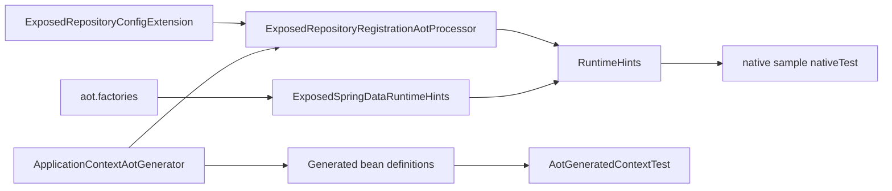

# Requirements

### Overview & Goals

Make `exposed-spring-data` work with Spring AOT (Spring Framework 7 / Spring Data 4.1.1) and GraalVM native images:

1. AOT processing of a context with `@EnableExposedRepositories` / `@EnableExposedAuditing` succeeds, and the generated bean definitions start a working
   context (`spring.aot.enabled=true`).
2. The module registers the runtime hints its reflection needs (table `object`s, entities, DTO / interface projections, internal infrastructure), so a native
   image can run CRUD, derived queries, projections, `query { }`, callbacks and auditing.

### Scope

#### In Scope

- `ExposedRepositoryRegistrationAotProcessor` (subclass of commons' `RepositoryRegistrationAotProcessor`) returned from
  `ExposedRepositoryConfigExtension.getRepositoryAotProcessor()`, registering hints per repository.
- A static `ExposedSpringDataRuntimeHints : RuntimeHintsRegistrar` in a new `src/main/resources/META-INF/spring/aot.factories` for fixed internal types.
- A JVM test that runs AOT processing, compiles the generated code with `spring-core-test`'s `TestCompiler`, starts the generated context and runs repository
  operations on H2.
- An opt-in native-image sample (`samples/exposed-spring-data-native`) with `nativeTest`, not part of the normal build.
- Docs: KDoc / README note that dynamic `Class<T>` projections and `query { }` target types need `@RegisterReflectionForBinding`.

#### Out of Scope

- AOT repositories (generated repository source code, `AotRepositoryCreator`).
- An `exposedManagedTypes` bean / `ManagedTypes` integration (not chosen).
- JVM-only hint-predicate tests and the runtime-hints agent task (not chosen).
- Making Exposed core itself fully native-ready beyond what the sample needs; gaps found there are reported, not fixed.
- Running native tests in CI.

### User Stories

- As a Spring Boot user, I want to build my app with `processAot` / native image and have Exposed repositories work without writing hints myself.
- As a maintainer, I want a fast JVM test that fails when a change breaks AOT bean-definition generation.

### Functional Requirements

- For every repository the processor registers:
  - the `@ExposedRepository` table class: `INSTANCE` field, declared fields and methods (getters of `Column` properties), `kotlin.Metadata`;
  - the domain type: declared constructors, fields and methods;
  - every static projection type found in query-method and default-method return types (unwrapping `List`, `Optional`, `Page`, `Slice`, `Window`, `Stream`):
    DTO → constructors/fields/methods; interface → JDK proxy with the interfaces commons' `ProxyProjectionFactory` adds, plus reflection on the interface.
- The static registrar covers internal classes created by name or reflection (`ExposedRepositoryFactoryBean`, `SimpleExposedRepository`, `ExposedMappingContext`,
  `ExposedAuditingCallback`, registrar classes) and anything commons doesn't already cover.
- Processing ahead of time must not need a database connection.
- The generated context runs save / findById / a derived query / a DTO + interface projection / `query { }` / auditing on H2 with the same results as the normal
  context.
- The native sample's `nativeTest` passes the same operations in a native image.

# Technical Design

### Current Implementation

- `ExposedRepositoryConfigExtension` (`repository/`) extends `RepositoryConfigurationExtensionSupport`, registers the `exposedMappingContext` bean in
  `registerBeansForRoot`, and does not override `getRepositoryAotProcessor()` (so commons' default `RepositoryRegistrationAotProcessor` is used).
- Reflection the module does at runtime:
  - `ExposedRepositoryFactory.tableFor`: `@ExposedRepository(table)` → `KClass.objectInstance`.
  - `EntityMetadata`: `table::class.memberProperties`, `domainType.memberProperties` (kotlin-reflect).
  - `ExposedMappingContext` / `EntityConverter`: `EntityInstantiators`, property accessors, `@Id` / `@Version` field scans.
  - `ConstructorConverter`: DTO `primaryConstructor.callBy`; `InterfaceConverter`: `ProjectionFactory.createProjection` (JDK proxies).
  - `query { }` default methods via commons' `DefaultMethodInvokingMethodInterceptor`.
  - `ExposedAuditingRegistrar` registers `IsNewAwareAuditingHandler` + `ExposedAuditingCallback` with bean-name references.
- Commons 4.1.1 `META-INF/spring/aot.factories` already provides `RepositoryRuntimeHints`, `AuditingBeanRegistrationAotProcessor` and the managed-types
  processor; `RepositoryRegistrationAotProcessor` exposes `protected configureTypeContributions(...)` / `contributeType(...)`.
- `exposed-spring-data` has no `src/main/resources`, is not in `exposed-bom`, and isn't published; `samples/exposed-spring` uses the published catalog.

### Key Decisions

- **Per-repository hints through a repository AOT processor** (user choice), plus a small static registrar for fixed internal types. No `ManagedTypes` bean.
- **Verification = generated context on the JVM + a native sample** (user choice). No hint-predicate unit tests, no agent task.
- **Native sample is opt-in**: a standalone Gradle build under `samples/` that consumes the module through a composite build (`includeBuild("../..")`), so the
  main build and CI don't need GraalVM.
- **Dynamic projections stay user responsibility**: types only known at call time (`Class<T>` arguments, `query<T> { }`) are documented to need
  `@RegisterReflectionForBinding`.

### Proposed Changes

- `ExposedRepositoryConfigExtension.getRepositoryAotProcessor()` returns `ExposedRepositoryRegistrationAotProcessor::class.java`.
- `ExposedRepositoryRegistrationAotProcessor.configureTypeContributions(repositoryContext, generationContext)`: call `super`, then read
  `repositoryContext.repositoryInformation` and register (via `generationContext.runtimeHints`):
  - table class from `@ExposedRepository` (reflection on declared fields/methods, `INSTANCE`);
  - domain type (constructors, fields, methods);
  - projection types collected from return types of every declared method (resolve with commons `TypeInformation.fromReturnTypeOf(method).actualType`, skip
    `ResultRow`, the entity, `java.*`/`kotlin.*`): class → constructors/methods; interface → reflection + `proxies().registerJdkProxy(type, TargetAware,
    SpringProxy, DecoratingProxy)` (exact interface set verified against `ProxyProjectionFactory` in 4.1.1).
- `ExposedSpringDataRuntimeHints`: reflection for internal infrastructure classes and `kotlin.Metadata`; registered in `META-INF/spring/aot.factories` under
  `org.springframework.aot.hint.RuntimeHintsRegistrar`.
- Fix whatever the generated-context test exposes (e.g. bean definitions that rely on instance suppliers or lambdas, the `ObjectFactory` used by
  `ExposedAuditingRegistrar`, `setBeanFactory` lookups in `ExposedRepositoryFactoryBean`).

### File Structure

```
exposed-spring-data/
  build.gradle.kts                                  (+ testImplementation spring-core-test, spring-test 7.0.8 via catalog)
  src/main/kotlin/.../spring/data/aot/
    ExposedRepositoryRegistrationAotProcessor.kt    (new, internal)
    ExposedSpringDataRuntimeHints.kt                (new, internal)
  src/main/kotlin/.../repository/ExposedRepositoryConfigExtension.kt  (override getRepositoryAotProcessor)
  src/main/resources/META-INF/spring/aot.factories  (new)
  src/test/kotlin/.../spring/data/AotGeneratedContextTest.kt          (new)
gradle/libs.versions.toml                           (+ spring7-core-test)
samples/exposed-spring-data-native/                 (new standalone build: settings, build.gradle.kts, app, nativeTest)
```

### Architecture Diagram



### Risks

- kotlin-reflect performs hidden lookups (`kotlin.Metadata`, `$$delegatedProperties`, builtins resources); the native sample is the only place this shows up.
- Exposed core may not be native-ready (`ServiceLoader` for `DatabaseConnectionAutoRegistration`, dialect lookup by class name); the sample may need its own
  hints, which are reported as findings.
- Composite build of the whole Exposed root from the sample may be slow or need dependency substitution for `org.jetbrains.exposed:exposed-spring-data`.
- Dynamic projections can't be discovered at build time.

# Testing

### Validation Approach

- **JVM, every build:** `AotGeneratedContextTest` in `exposed-spring-data`:
  1. Register an AOT test configuration (`@EnableExposedRepositories` with nested repositories, `@EnableExposedAuditing`, H2 `DataSource`,
     `SpringTransactionManager`) on a `GenericApplicationContext`.
  2. `ApplicationContextAotGenerator().processAheadOfTime(context, DefaultGenerationContext(...))`.
  3. `TestCompiler.forSystem().with(generatedFiles).compile { compiled -> ... }`: load the generated `ApplicationContextInitializer`, start a fresh
     `GenericApplicationContext` with it, and run the operations below.
- **Native, opt-in/manual:** `cd samples/exposed-spring-data-native && ./gradlew nativeTest` (GraalVM 25 + Native Build Tools).
- Existing suite: `./gradlew :exposed-spring-data:test_h2_v2` stays at 399 green; `detekt` shows only the existing `RowConverter.kt` TODO.

### Key Scenarios (generated context and native test)

- AOT processing completes without opening a DB connection.
- `customerRepository` bean exists and is an `ExposedRepositoryFactoryBean` product; `exposedMappingContext` is a single shared bean.
- `save` assigns an id; `findById` returns it.
- A derived query (`findByEmail`) and a paged query return correct results.
- DTO and interface projections, plus `query { }` returning entities and a DTO.
- Auditing sets created/modified fields with the named `AuditorAware` / `DateTimeProvider`.
- An entity callback bean is invoked.

### Edge Cases

- Interface projection proxies (native only: missing proxy hint fails at call time).
- `Persistable` entity with private `id` (field access through hints).
- Repository with no projections still processes.

### Test Changes

- New `AotGeneratedContextTest.kt` (own nested repositories and fixtures, separate context so the shared one is untouched).
- New native sample tests in `samples/exposed-spring-data-native/src/test`.

# Delivery Steps

### ✓ Step 1: Add the generated-context AOT test
`AotGeneratedContextTest` processes a full Exposed Spring Data context ahead of time, compiles the generated code and runs repository operations on H2.

- Add `spring7-core-test` to `gradle/libs.versions.toml` (version `springFramework7`) and `testImplementation` it (plus `spring7-test` if not transitively present).
- Fixtures with nested repositories: entity + derived query + paging, DTO and interface projection, `query { }` default methods, `Persistable` entity, auditing
  with named `AuditorAware` / `DateTimeProvider`, one entity callback bean.
- Steps: `ApplicationContextAotGenerator.processAheadOfTime` → `TestCompiler` → start context from the generated initializer → assert the Key Scenarios.
- Run it, record what fails (expected: anything relying on non-generatable bean definitions), and fix bean-definition issues in
  `ExposedRepositoryConfigExtension`, `ExposedAuditingRegistrar`, `ExposedRepositoryFactoryBean` until it is green.
- Full module suite stays at 399+ green; detekt baseline unchanged.

### ✓ Step 2: Register runtime hints per repository and for internal classes
The AOT run contributes reflection and proxy hints for every table, entity and static projection, plus the module's internal infrastructure.

- New `aot/ExposedRepositoryRegistrationAotProcessor` overriding `configureTypeContributions`: table object, domain type, projection types from method return
  types (DTO reflection, interface JDK proxy with the interfaces `ProxyProjectionFactory` adds).
- Override `ExposedRepositoryConfigExtension.getRepositoryAotProcessor()` to return it.
- New `aot/ExposedSpringDataRuntimeHints` + `src/main/resources/META-INF/spring/aot.factories` for internal classes and `kotlin.Metadata`.
- Re-run `AotGeneratedContextTest` and the module suite to make sure AOT processing with the new processor still succeeds.
- KDoc on `@EnableExposedRepositories` / `query { }`: dynamic `Class<T>` and `query<T> { }` targets need `@RegisterReflectionForBinding`.

### ✓ Step 3: Add the opt-in native-image sample
`samples/exposed-spring-data-native` builds a native image and its `nativeTest` exercises the same scenarios.

- Standalone Gradle build (Spring Boot 4.1 plugin, GraalVM Native Build Tools, Kotlin + `plugin.spring`), consuming the module via `includeBuild("../..")`.
- Small app: H2 `DataSource`, `SpringTransactionManager`, `@EnableExposedRepositories`, `@EnableExposedAuditing`, the same repository shapes as the JVM test.
- Tests (JUnit, run by `nativeTest`) for CRUD, derived query, projections, `query { }`, auditing, callback.
- Run `./gradlew nativeTest` where GraalVM is available; add any extra hints the module needs to `ExposedSpringDataRuntimeHints`, and list Exposed-core gaps
  (with workaround hints in the sample) in the sample README.

### ✓ Step 4: Update / Follow-up
I tried executing nativeRun of the sample and it failes in nativeCompile step