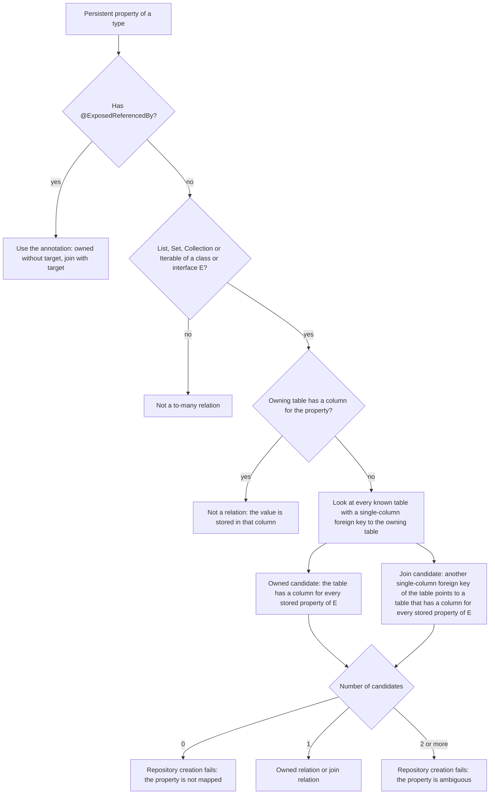
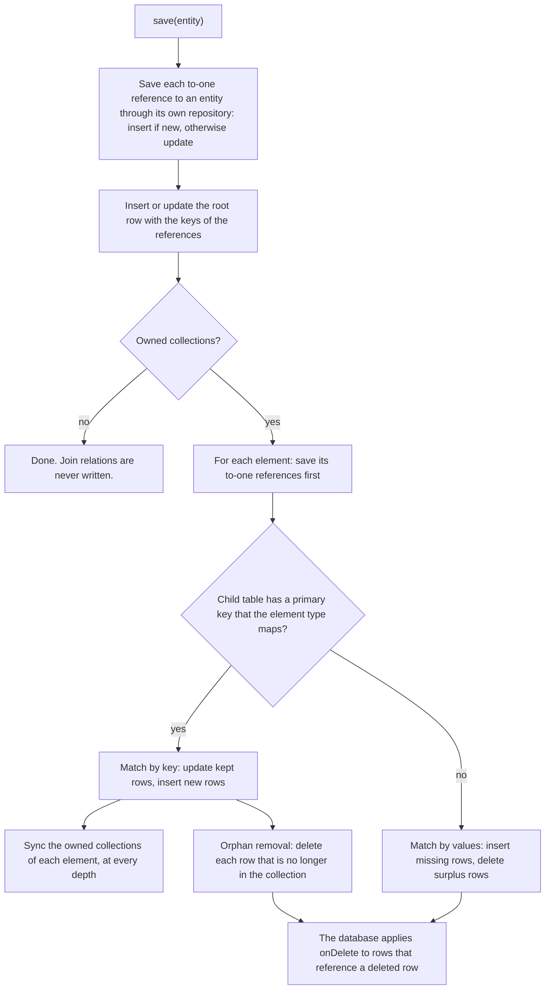
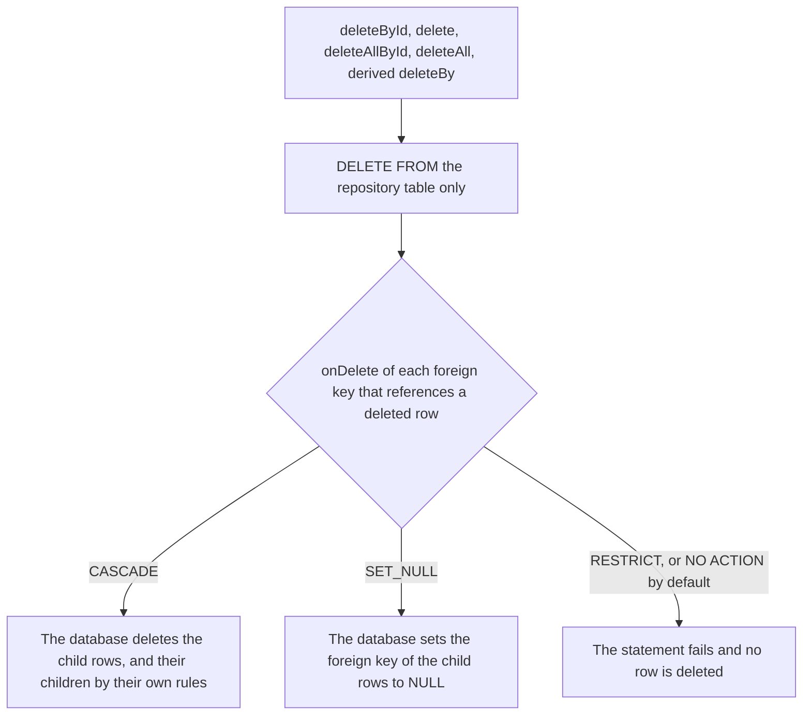
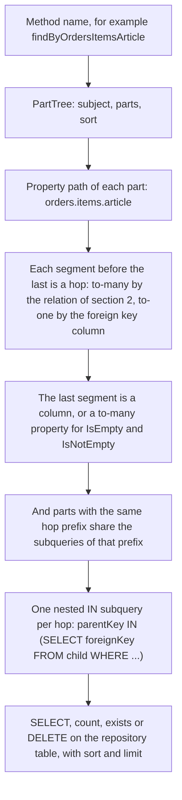

# Spring Data Exposed: relations, saving, deleting and derived queries

This document describes how Spring Data Exposed repositories find the relations of an aggregate, and how they read, save,
delete and query it. All tables, types, methods and results come from passing tests of the `exposed-spring-data` module.

All SQL blocks and error messages are exact H2 output. Only line breaks and indentation were added to the SQL. Sources:

- `SemanticsDocumentExamplesTest`: most texts. The test asserts each text and prints it as a `DOC <label>: <text>`
  line in its JUnit XML report.
- `InferredRelationRepositoryTest`: the "Candidates in several tables" message of section 2.3.
- `DerivedQueryJoinTest`: the `SET_NULL` delete statement of section 7.8.
- `InferredRelationRepositoryTest` and `AggregateRepositoryTest`: the H2 text `Referential integrity constraint violation`
  of section 7.8.

The inline patterns in section 6, such as `ownerKey NOT IN (...)`, are illustrations, not captured SQL.

## 1. Concepts

| Term | Meaning |
|---|---|
| Aggregate | The entity type of a repository, with all objects and collections that it holds. The repository's table holds the root row. |
| To-one reference | A property of a class type stored in a foreign key column, for example `buyer: Buyer` in `Purchases.buyer`. |
| To-many relation | A collection property whose elements are rows of another table. It has no column in the owning table. |
| Owned relation | A one-to-many relation. The child rows reference the owning row and belong to the aggregate. |
| Join relation | A many-to-many relation. A join table references the owning row and, with a second foreign key (the target), the element rows. |
| Known tables | The `Table` objects in the base packages of `@EnableExposedRepositories` and their sub-packages. |

Names in this document have two forms:

- Kotlin names: the table object and its column property, for example `Transfers.from`. `@ExposedReferencedBy` and
  `@ExposedColumn` use these names. Error messages show foreign keys with these names.
- SQL names: the names in the database, for example `inferred_accounts` or `from_id`. Error messages show the owning table
  with its SQL name.

## 2. Relation resolution

### 2.1 Known tables

- The repository infrastructure scans the base packages once per application context.
- Top-level, nested and companion `Table` objects are found. Table classes that aren't objects are skipped.
- With several `@EnableExposedRepositories`, the known tables are the tables of all their base packages.
- Tables are compared by identity, not by name.
- A table outside the base packages isn't known. A relation to it needs `@ExposedReferencedBy`.

### 2.2 Rules



Rules for the element type `E`:

- A simple type such as `String`, a number, an enum or a value class isn't a relation element. `List<String>` is never a
  relation.
- For a class, only properties with a backing field count as stored. For an interface, all properties count.
- To-many collections, `Map` properties and `@Transient` properties of `E` are skipped.
- Each stored property matches the column with the same Kotlin name in the table object. `@ExposedColumn("name")` on the
  property selects the column with that Kotlin name.

Other rules:

- Multi-column foreign keys are ignored.
- There are no naming heuristics. A foreign key or a table is never selected by its name.
- An annotated property always uses the annotation. Inference is skipped for it.
- The repository resolves all relations of the aggregate, at every depth, when it is created.

### 2.3 Errors and fixes

Each message below is the exact text of the `IllegalArgumentException` that the test fixture produces. The fixtures of
the last three rows are in sections 7.4 and 7.5.

| Situation | Message | Fix |
|---|---|---|
| No candidate | `Shop.orders is not mapped: no known table has a foreign key to shops whose rows, or the rows they reference, have a column for every property of ShopOrder. Annotate 'orders' with @ExposedReferencedBy(<Table>::class), or make sure the table is in a scanned package` | Move the child table into a base package, or annotate the property. |
| Two foreign keys from one table | `Account.outgoing is ambiguous, these relations to inferred_accounts fit: Transfers.from (one-to-many), Transfers.to (one-to-many). Annotate it with @ExposedReferencedBy(Transfers::class, column = "...") to choose one (set the column)` | Set `column`. |
| One join table, two targets | `Board.tags is ambiguous, these relations to inferred_boards fit: BoardTagLinks.board with target BoardTagLinks.primary (many-to-many to tags), BoardTagLinks.board with target BoardTagLinks.secondary (many-to-many to tags). Annotate it with @ExposedReferencedBy(BoardTagLinks::class, target = "...") to choose one (set the target)` | Set `target`. |
| Candidates in several tables | `Board.tags is ambiguous, these relations to inferred_boards fit: BoardTagLinks.board with target BoardTagLinks.primary (many-to-many to tags), BoardTagLinks.board with target BoardTagLinks.secondary (many-to-many to tags), BoardFeaturedTags.board with target BoardFeaturedTags.tag (many-to-many to tags). Annotate it with @ExposedReferencedBy(BoardTagLinks::class or BoardFeaturedTags::class, target = "...") to choose one (set the table and target)` | Set the table, and `target` if that table has several. |

An ambiguous relation deep in the aggregate fails at repository creation too. The message names the property, not the
query path. `Bank → accounts → outgoing` gives:

```
BankAccount.outgoing is ambiguous, these relations to inferred_bank_accounts fit: BankTransfers.from (one-to-many), BankTransfers.to (one-to-many). Annotate it with @ExposedReferencedBy(BankTransfers::class, column = "...") to choose one (set the column)
```

## 3. Reading

- An aggregate is loaded with all its relations, at every depth. There are no lazy proxies.
- The repository first runs the root query. Then it runs one query per relation and level for all loaded parents.
- Owned collections hold the child rows. If the child table has a primary key, the rows are ordered by it.
- Join collections hold the rows that the target foreign key of the join table references.
- `AggregateRepositoryTest` loads 3 purchases with 6 selects: purchases, buyers, countries, lines, notes and label links.

`shops.findById(id)` for a shop with one order and one item:

```sql
SELECT SHOPS.ID, SHOPS."name" FROM SHOPS WHERE SHOPS.ID = ?
SELECT SHOP_ORDERS.ID, SHOP_ORDERS."number", SHOP_ORDERS.SHOP_ID FROM SHOP_ORDERS WHERE SHOP_ORDERS.SHOP_ID = ? ORDER BY SHOP_ORDERS.ID ASC
SELECT SHOP_ORDER_ITEMS.ID, SHOP_ORDER_ITEMS.ARTICLE, SHOP_ORDER_ITEMS.QUANTITY, SHOP_ORDER_ITEMS.ORDER_ID FROM SHOP_ORDER_ITEMS WHERE SHOP_ORDER_ITEMS.ORDER_ID = ? ORDER BY SHOP_ORDER_ITEMS.ID ASC
SELECT SHOP_ORDER_TAGS.ORDER_ID, SHOP_ORDER_TAGS.TAG_ID FROM SHOP_ORDER_TAGS WHERE SHOP_ORDER_TAGS.ORDER_ID = ? ORDER BY SHOP_ORDER_TAGS.ORDER_ID ASC, SHOP_ORDER_TAGS.TAG_ID ASC
```

## 4. Saving



### 4.1 To-one references

- `save` saves a referenced entity through the repository of its table before it writes the referencing row. A new
  entity is inserted, an existing one is updated. The usual `isNew` rules apply.
- The cascade applies only when the foreign key references the `id` column of an `IdTable`. The property type must also
  map its id property to that column. For any other reference, `save` only reads the key from the object.
- A property declared as a key (`buyer: Long`) stores the key. Nothing is saved.
- A `null` value of a nullable reference stores `NULL`.
- Deleting never removes referenced entities.

### 4.2 Owned collections

- Match by key: the child table has a primary key, and the element type maps all its columns. Kept rows are updated, so
  they keep their identity. Elements without a key are inserted.
- Match by values: the child table has no such key. Only surplus rows are deleted and only missing values are inserted.
  An element type with its own owned collections can't use this mode, so `save` fails.
- Orphan removal and the surplus deletes of match by values delete only rows of the child table. The application never
  deletes their children. The `onDelete` rules of the foreign keys to the deleted rows apply.

Orphan removal of the only order of a shop:

```sql
DELETE FROM SHOP_ORDERS WHERE SHOP_ORDERS.ID = ?
```

### 4.3 Join relations

Join relations are read-only. `save` writes neither the join table nor the target rows. A change to the collection is
ignored. Write the join rows with the Exposed DSL.

## 5. Deleting



- Every delete method of the repository deletes only rows of the repository's table.
- A derived `deleteBy` that returns the entities loads them, with their relations, before it deletes them.
- The database is the only source of the delete cascade. Declare `onDelete` on every child foreign key.

| `onDelete` | Result | Test |
|---|---|---|
| `ReferenceOption.CASCADE` | The child rows are deleted, and their children by their own rules. | `ShopOrders`, `ShopOrderItems`, `PurchaseLines`, `PurchaseNotes`, `PurchaseLabels` |
| `ReferenceOption.SET_NULL` | The foreign key of the child rows is set to `NULL`. The rows stay. The column must be nullable. | `OrderComments.replyTo` |
| `ReferenceOption.RESTRICT` | The delete fails with a constraint violation. No row is deleted. | `DepotBins`, `DepotSlots` |
| No rule | The database default applies. H2 rejects the delete like `RESTRICT`. Most other databases use `NO ACTION`, with the same result. | `Purchases.buyer` |

Orphan removal and the delete cascade are different:

| | Orphan removal | Delete cascade |
|---|---|---|
| Trigger | `save` with a collection that no longer holds a row. | Any repository delete of a parent row. |
| Done by | The application, with one `DELETE` per removed row. | The database, by the `onDelete` rule. |
| Children of the deleted row | The database, by the `onDelete` rule. | The database, by the `onDelete` rule. |

## 6. Derived queries



### 6.1 Rules

- A to-many hop uses the same relation as reading and saving, inferred or annotated, at any depth.
- A join relation adds two hops: the join table, then the target table.
- A to-one hop uses the foreign key column. `findByBuyerId` compares the foreign key column directly, without a
  subquery. `findByBuyer(buyer)` compares the foreign key column with the key of `buyer`.
- The query selects only from the repository's table, so rows are never duplicated. Count, exists, delete and paging
  work as without hops.
- `And` parts with the same prefix share one subquery per hop, so all of them must match the same child row.
- `Or` parts always get their own subqueries.
- An invalid path fails at repository creation.

### 6.2 Supported keywords

| Keyword | Condition |
|---|---|
| none, `Is`, `Equals` | equal |
| `Not`, `IsNot` | not equal |
| `Between` | between two values |
| `IsNull`, `IsNotNull` | `IS NULL`, `IS NOT NULL` |
| `LessThan`, `LessThanEqual`, `GreaterThan`, `GreaterThanEqual` | comparison |
| `Before`, `After` | comparison |
| `Like`, `NotLike` | `LIKE` with the given pattern |
| `StartingWith`, `EndingWith`, `Containing`, `NotContaining` | `LIKE` with escaped `%` and `_` |
| `In`, `NotIn` | in a collection of values |
| `Regex` | regular expression match |
| `True`, `False` | boolean column |
| `IsEmpty`, `IsNotEmpty` | Only on a path that ends on a to-many property. |
| `IgnoreCase`, `AllIgnoreCase` | Case-insensitive match on string columns. |

Subjects: `find…By`, `count…By`, `exists…By`, `delete…By`, `First`/`Top`, `Distinct`. Return types `List`, `Page`,
`Slice`, `Window` and a single nullable entity or projection work as in Spring Data.

### 6.3 `IsEmpty` and `IsNotEmpty`

- `IsEmpty` on `orders` gives `ownerKey NOT IN (SELECT foreignKey FROM child WHERE foreignKey IS NOT NULL)`.
- The `IS NOT NULL` condition is necessary for nullable foreign keys. Without it, one `NULL` makes `NOT IN` match no row.
- `IsNotEmpty` gives `ownerKey IN (SELECT foreignKey FROM child)`.
- On a nested path, the condition applies to some row of the prefix. `findByOrdersItemsIsEmpty` means "has an order
  without items", not "has no items in any order".
- On a property that isn't a to-many relation, repository creation fails:

```
'number' of the path 'orders.number' is no to-many relation (a collection, inferred or annotated with @ExposedReferencedBy), so it can't be checked for emptiness
```

### 6.4 Sorting

- Sorting by a to-one path (`OrderByBuyerNameAsc`, `Sort.by("buyer.name")`) adds a `LEFT JOIN` under an alias. It
  works with paging and keyset scrolling.
- Sorting by a to-many path is rejected, because a parent can have many values:
  - In the method name, repository creation fails: `Sorting by 'lines.article' is not supported, the path goes through a to-many property`.
  - In a `Sort` parameter, the call fails with an `IllegalArgumentException` and the same message.

## 7. Use cases

The tables and types below are copied from the test fixtures.

### 7.1 One-to-many and three-level nested aggregate

```kotlin
object Shops : LongIdTable("shops") {
    val name = varchar("name", 255)
}

object ShopOrders : LongIdTable("shop_orders") {
    val shop = reference("shop_id", Shops, onDelete = ReferenceOption.CASCADE)
    val number = varchar("number", 255)
}

object ShopOrderItems : LongIdTable("shop_order_items") {
    val order = reference("order_id", ShopOrders, onDelete = ReferenceOption.CASCADE)
    val article = varchar("article", 255)
    val quantity = integer("quantity")
}

data class ShopOrderItem(val id: Long? = null, val article: String, val quantity: Int)
data class ShopOrder(val id: Long? = null, val number: String, val items: List<ShopOrderItem> = emptyList(), val tags: Set<Tag> = emptySet())
data class Shop(val id: Long? = null, val name: String, val orders: List<ShopOrder> = emptyList())

@ExposedRepository(table = Shops::class)
interface ShopRepository : ExposedCrudRepository<Shop, Long>
```

Behavior (`InferredRelationRepositoryTest`):

- `Shop.orders` and `ShopOrder.items` are owned relations. No annotation is necessary.
- `findById` loads the shop, its orders and their items.
- `save` inserts all three levels. A second `save` with changed collections updates kept rows with the same ids, inserts
  new ones and deletes removed orders. The items of a removed order follow through `ON DELETE CASCADE`.

### 7.2 Many-to-many through a join table

```kotlin
object Tags : LongIdTable("tags") {
    val name = varchar("name", 255)
}

object ShopOrderTags : Table("shop_order_tags") {
    val order = reference("order_id", ShopOrders, onDelete = ReferenceOption.CASCADE)
    val tag = reference("tag_id", Tags, onDelete = ReferenceOption.CASCADE)
    override val primaryKey = PrimaryKey(order, tag)
}

data class Tag(val id: Long? = null, val name: String)
```

Behavior:

- `ShopOrder.tags` is a join relation. `ShopOrderTags` has no `name` column, so it isn't an owned candidate. Its second
  foreign key `tag` points to `Tags`, which fits `Tag`.
- `save` writes no row into `shop_order_tags` and no new tag. A collection change is ignored.

### 7.3 Self reference

```kotlin
object ShopEmployees : LongIdTable("shop_employees") {
    val name = varchar("name", 255)
    val manager = optReference("manager_id", ShopEmployees, onDelete = ReferenceOption.CASCADE)
}

data class ShopEmployee(val id: Long? = null, val name: String, val manager: Long? = null, val reports: List<ShopEmployee> = emptyList())

@ExposedRepository(table = ShopEmployees::class)
interface ShopEmployeeRepository : ExposedCrudRepository<ShopEmployee, Long> {
    fun findByReportsIsEmpty(): List<ShopEmployee>
    fun findByReportsIsNotEmpty(): List<ShopEmployee>
    fun findByReportsReportsIsNotEmpty(): List<ShopEmployee>
}
```

Behavior with `Boss ← Lead ← Dev`:

- `reports` is an owned relation of the table to itself. `findById(boss)` loads `Lead` and its report `Dev`.
- `findByReportsIsEmpty()` returns `Dev`. `findByReportsIsNotEmpty()` returns `Boss` and `Lead`.
  `findByReportsReportsIsNotEmpty()` returns `Boss`.

```sql
-- findByReportsIsEmpty
SELECT SHOP_EMPLOYEES.ID, SHOP_EMPLOYEES."name", SHOP_EMPLOYEES.MANAGER_ID FROM SHOP_EMPLOYEES
WHERE SHOP_EMPLOYEES.ID NOT IN (SELECT SHOP_EMPLOYEES.MANAGER_ID FROM SHOP_EMPLOYEES WHERE SHOP_EMPLOYEES.MANAGER_ID IS NOT NULL)
```

`Boss` has `manager_id = NULL`. Without the `IS NOT NULL` condition, the query returns no row.

### 7.4 Ambiguous foreign key, fixed with `column`

```kotlin
object Accounts : LongIdTable("inferred_accounts") {
    val name = varchar("name", 255)
}

object Transfers : LongIdTable("inferred_transfers") {
    val from = reference("from_id", Accounts)
    val to = reference("to_id", Accounts)
    val amount = integer("amount")
}

data class Transfer(val id: Long? = null, val amount: Int)
data class Account(val id: Long? = null, val name: String, val outgoing: List<Transfer> = emptyList())
```

- Repository creation for `Account` fails with the "Two foreign keys from one table" message of section 2.3.
- The fix names the column by its Kotlin name, `"from"`, not `"from_id"`:

```kotlin
data class AnnotatedAccount(
    val id: Long? = null,
    val name: String,
    @ExposedReferencedBy(Transfers::class, column = "from") val outgoing: List<Transfer> = emptyList(),
)
```

With transfers Alice → Bob (10, 11) and Bob → Alice (20), Alice's `outgoing` is `[10, 11]` and Bob's is `[20]`.

### 7.5 Ambiguous join target, fixed with `target`

```kotlin
object Boards : LongIdTable("inferred_boards") {
    val name = varchar("name", 255)
}

object BoardTagLinks : Table("inferred_board_tag_links") {
    val board = reference("board_id", Boards)
    val primary = reference("primary_tag_id", Tags)
    val secondary = reference("secondary_tag_id", Tags)
}

data class Board(val id: Long? = null, val name: String, val tags: Set<Tag> = emptySet())
```

- If only `BoardTagLinks` is known, repository creation for `Board` fails with the "One join table, two targets" message
  of section 2.3.
- The fix names the target by its Kotlin name, `"primary"`, not `"primary_tag_id"`:

```kotlin
data class PrimaryTagBoard(
    val id: Long? = null,
    val name: String,
    @ExposedReferencedBy(BoardTagLinks::class, target = "primary") val tags: Set<Tag> = emptySet(),
)

@ExposedRepository(table = Boards::class)
interface PrimaryTagBoardRepository : ExposedCrudRepository<PrimaryTagBoard, Long>
```

Data: board "Desk" has one link row with the primary tag "urgent" and the secondary tag "gift".

- `tags` is a join relation through `BoardTagLinks.board`, with the target `BoardTagLinks.primary`.
- `findById(desk)` loads the tags `{"urgent"}`. The secondary tag "gift" isn't loaded.

### 7.6 Override

An annotation replaces inference for its property. It can select another table and another target than inference.
The annotated table doesn't need to be known.

A second join table from `Boards` to `Tags`, with the tables of section 7.5:

```kotlin
object BoardFeaturedTags : Table("inferred_board_featured_tags") {
    val board = reference("board_id", Boards)
    val tag = reference("tag_id", Tags)
}

data class SecondaryTagBoard(
    val id: Long? = null,
    val name: String,
    @ExposedReferencedBy(BoardTagLinks::class, target = "secondary") val tags: Set<Tag> = emptySet(),
)
```

Data: board "Desk" of section 7.5, and one `BoardFeaturedTags` row with the tag "new". Only `BoardFeaturedTags` is
known:

| Repository | Relation of `tags` | Tags of "Desk" |
|---|---|---|
| `Board`, inferred | `BoardFeaturedTags.board`, target `BoardFeaturedTags.tag` | `{"new"}` |
| `SecondaryTagBoard`, annotated | `BoardTagLinks.board`, target `BoardTagLinks.secondary` | `{"gift"}` |

If `BoardTagLinks` and `BoardFeaturedTags` are both known, `Board` fails with the "Candidates in several tables"
message of section 2.3.

Overrides with `column`:

- `AnnotatedAccount.outgoing` in section 7.4.
- `Order.comments` in `DerivedQueryJoinTest`. `OrderComments` references `Orders` twice:

```kotlin
object OrderComments : Table("order_comments") {
    val order = reference("order_id", Orders, onDelete = ReferenceOption.CASCADE)
    val replyTo = optReference("reply_to_id", Orders, onDelete = ReferenceOption.SET_NULL)
    val text = varchar("text", 255)
}

data class Order(
    val id: Long? = null,
    val customer: Long,
    val note: String,
    @ExposedReferencedBy(OrderItems::class)
    val items: List<OrderItem> = emptyList(),
    @ExposedReferencedBy(OrderComments::class, column = "order")
    val comments: List<OrderComment> = emptyList(),
)
```

`findByCommentsText("slow")` matches comments by `order`, not by `replyTo`:

```sql
SELECT ORDERS.ID, ORDERS.CUSTOMER_ID, ORDERS.NOTE FROM ORDERS
WHERE ORDERS.ID IN (SELECT ORDER_COMMENTS.ORDER_ID FROM ORDER_COMMENTS WHERE ORDER_COMMENTS.TEXT = ?)
```

### 7.7 To-one cascade

```kotlin
object Countries : LongIdTable("countries") {
    val name = varchar("name", 255)
}

object Buyers : LongIdTable("buyers") {
    val name = varchar("name", 255)
    val country = optReference("country_id", Countries)
}

object Purchases : LongIdTable("purchases") {
    val buyer = reference("buyer_id", Buyers)
    val giftFor = optReference("gift_for_id", Buyers)
    val note = varchar("note", 255)
}

data class Country(val id: Long? = null, val name: String)
data class Buyer(val id: Long? = null, val name: String, val country: Country? = null)

data class Purchase(
    val id: Long? = null,
    val buyer: Buyer,
    @ExposedColumn("giftFor") val recipient: Buyer? = null,
    val note: String,
    val lines: List<PurchaseLine> = emptyList(),
    val notes: List<PurchaseNote> = emptyList(),
    val labels: Set<Label> = emptySet(),
)
```

Behavior (`AggregateRepositoryTest`):

- `save(Purchase(buyer = Buyer(name = "Ann", country = Country(name = "Germany"))))` inserts the country, then the buyer,
  then the purchase. The returned copy has all ids.
- `save` with an existing buyer renamed to "Anna" updates the buyer row. No second buyer is inserted.
- `recipient` is stored in `Purchases.giftFor`, selected with `@ExposedColumn`. `null` stores `NULL`.
- Deleting purchases doesn't delete buyers.
- `Purchase.lines`, `notes` and `labels` have no annotation. They are inferred: two owned relations and one join
  relation.

### 7.8 `onDelete` variants

`CASCADE`, with the shop tables of section 7.1:

- `deleteById`, `delete`, `deleteAllById`, `deleteAll(entities)`, `deleteByName`, `deleteAllByName` and `deleteAll()`
  each send `DELETE` statements only for `shops`. The database deletes the orders, their items and their tag links.

```sql
-- shops.deleteById(id)
DELETE FROM SHOPS WHERE SHOPS.ID = ?
-- shops.deleteByName("Pens")
DELETE FROM SHOPS WHERE SHOPS."name" = ?
```

`RESTRICT`:

```kotlin
object Depots : LongIdTable("inferred_depots") {
    val name = varchar("name", 255)
}

object DepotBins : LongIdTable("inferred_depot_bins") {
    val depot = reference("depot_id", Depots, onDelete = ReferenceOption.RESTRICT)
    val label = varchar("label", 255)
}

object DepotSlots : LongIdTable("inferred_depot_slots") {
    val bin = reference("bin_id", DepotBins, onDelete = ReferenceOption.RESTRICT)
    val code = varchar("code", 255)
}
```

- Every delete method of the depot repository fails for a depot with bins. H2 reports
  `Referential integrity constraint violation`.
- `save(depot.copy(bins = emptyList()))` fails too. Orphan removal deletes the bin, and its slot restricts that delete.
- After the failures, the depot, its bin and its slot are unchanged.

`SET_NULL`, with the order tables of section 7.6. Order 1 has two items "Pen", one item "Pad" and the comment "fast".
Order 2 has the item "pencil" and the comment "slow", which replies to order 1 (`replyTo = 1`):

- `orders.deleteById(1)` sends only `DELETE FROM ORDERS WHERE ORDERS.ID = ?`.
- `OrderComments.order` and `OrderItems.order` are `CASCADE`. The database deletes the comment "fast" and the three
  items of order 1. Only the item "pencil" stays.
- `OrderComments.replyTo` is `SET_NULL`. The comment "slow" stays with order 2 and `reply_to_id = NULL`.

No rule, with the purchase tables of section 7.7:

- `Purchases.buyer` has no `onDelete`. `buyers.deleteById` for a buyer of a purchase fails. H2 reports
  `Referential integrity constraint violation`.
- After the failure, the purchase and the buyer are unchanged.

### 7.9 Deep query with a shared prefix

```kotlin
fun findByOrdersItemsArticle(article: String): List<Shop>
fun findByOrdersItemsArticleAndOrdersItemsQuantity(article: String, quantity: Int): List<Shop>
fun findByOrdersTagsName(name: String): List<Shop>
```

```sql
-- findByOrdersItemsArticle
SELECT SHOPS.ID, SHOPS."name" FROM SHOPS
WHERE SHOPS.ID IN (SELECT SHOP_ORDERS.SHOP_ID FROM SHOP_ORDERS
  WHERE SHOP_ORDERS.ID IN (SELECT SHOP_ORDER_ITEMS.ORDER_ID FROM SHOP_ORDER_ITEMS WHERE SHOP_ORDER_ITEMS.ARTICLE = ?))

-- findByOrdersItemsArticleAndOrdersItemsQuantity
SELECT SHOPS.ID, SHOPS."name" FROM SHOPS
WHERE SHOPS.ID IN (SELECT SHOP_ORDERS.SHOP_ID FROM SHOP_ORDERS
  WHERE SHOP_ORDERS.ID IN (SELECT SHOP_ORDER_ITEMS.ORDER_ID FROM SHOP_ORDER_ITEMS
    WHERE (SHOP_ORDER_ITEMS.ARTICLE = ?) AND (SHOP_ORDER_ITEMS.QUANTITY = ?)))

-- findByOrdersTagsName
SELECT SHOPS.ID, SHOPS."name" FROM SHOPS
WHERE SHOPS.ID IN (SELECT SHOP_ORDERS.SHOP_ID FROM SHOP_ORDERS
  WHERE SHOP_ORDERS.ID IN (SELECT SHOP_ORDER_TAGS.ORDER_ID FROM SHOP_ORDER_TAGS
    WHERE SHOP_ORDER_TAGS.TAG_ID IN (SELECT TAGS.ID FROM TAGS WHERE TAGS."name" = ?)))
```

Data: shop "Pens" has an item "Pen" with quantity 2 and an item "Ink" with quantity 1. Shop "Pads" has an item "Pen"
with quantity 1.

- `findByOrdersItemsArticleAndOrdersItemsQuantity("Pen", 1)` returns only "Pads", because both conditions must match
  the same item.
- The matching shops are returned with all their orders and items, not only the matching ones.

`Or` parts get their own subqueries (`AggregateRepositoryTest`):

```sql
-- findByLinesArticleOrLinesQuantity
SELECT PURCHASES.ID, PURCHASES.BUYER_ID, PURCHASES.GIFT_FOR_ID, PURCHASES.NOTE FROM PURCHASES
WHERE (PURCHASES.ID IN (SELECT PURCHASE_LINES.PURCHASE_ID FROM PURCHASE_LINES WHERE PURCHASE_LINES.ARTICLE = ?))
   OR (PURCHASES.ID IN (SELECT PURCHASE_LINES.PURCHASE_ID FROM PURCHASE_LINES WHERE PURCHASE_LINES.QUANTITY = ?))
```

To-one hops and sorting (`AggregateRepositoryTest`):

```sql
-- findByBuyerCountryName
SELECT PURCHASES.ID, PURCHASES.BUYER_ID, PURCHASES.GIFT_FOR_ID, PURCHASES.NOTE FROM PURCHASES
WHERE PURCHASES.BUYER_ID IN (SELECT BUYERS.ID FROM BUYERS
  WHERE BUYERS.COUNTRY_ID IN (SELECT COUNTRIES.ID FROM COUNTRIES WHERE COUNTRIES."name" = ?))

-- findByBuyerId
SELECT PURCHASES.ID, PURCHASES.BUYER_ID, PURCHASES.GIFT_FOR_ID, PURCHASES.NOTE FROM PURCHASES WHERE PURCHASES.BUYER_ID = ?

-- findByNoteStartingWithOrderByBuyerNameAsc
SELECT PURCHASES.ID, PURCHASES.BUYER_ID, PURCHASES.GIFT_FOR_ID, PURCHASES.NOTE FROM PURCHASES
LEFT JOIN BUYERS sort_0 ON PURCHASES.BUYER_ID = sort_0.ID WHERE PURCHASES.NOTE LIKE ? ESCAPE ? ORDER BY sort_0."name" ASC
```

### 7.10 `IsEmpty` and `IsNotEmpty`

Data: "Pens" has orders A-1 (items, tag "urgent") and A-2 (items). "Pads" has B-1 (items). "Shelf" has C-1 without
items. "Empty" has no orders.

| Method | Result |
|---|---|
| `findByOrdersIsEmpty()` | Empty |
| `findByOrdersIsNotEmpty()` | Pads, Pens, Shelf |
| `findByOrdersItemsIsNotEmpty()` | Pads, Pens |
| `findByOrdersItemsIsEmpty()` | Shelf |
| `findByOrdersTagsIsNotEmpty()` | Pens |
| `findByOrdersTagsIsEmpty()` | Pads, Pens, Shelf |
| `findByOrdersNumberAndOrdersItemsIsEmpty("C-1")` | Shelf |
| `findByOrdersNumberAndOrdersItemsIsEmpty("A-1")` | none |
| `findByOrdersIsEmptyOrName("Pads")` | Empty, Pads |
| `countByOrdersIsEmpty()` | 1 |
| `existsByOrdersItemsIsEmpty()` | true |

`findByOrdersTagsIsEmpty()` returns "Pens", because order A-2 of "Pens" has no tags.

```sql
-- findByOrdersIsEmpty
SELECT SHOPS.ID, SHOPS."name" FROM SHOPS
WHERE SHOPS.ID NOT IN (SELECT SHOP_ORDERS.SHOP_ID FROM SHOP_ORDERS WHERE SHOP_ORDERS.SHOP_ID IS NOT NULL)

-- findByOrdersItemsIsNotEmpty
SELECT SHOPS.ID, SHOPS."name" FROM SHOPS
WHERE SHOPS.ID IN (SELECT SHOP_ORDERS.SHOP_ID FROM SHOP_ORDERS
  WHERE SHOP_ORDERS.ID IN (SELECT SHOP_ORDER_ITEMS.ORDER_ID FROM SHOP_ORDER_ITEMS))

-- findByOrdersTagsIsEmpty
SELECT SHOPS.ID, SHOPS."name" FROM SHOPS
WHERE SHOPS.ID IN (SELECT SHOP_ORDERS.SHOP_ID FROM SHOP_ORDERS
  WHERE SHOP_ORDERS.ID NOT IN (SELECT SHOP_ORDER_TAGS.ORDER_ID FROM SHOP_ORDER_TAGS WHERE SHOP_ORDER_TAGS.ORDER_ID IS NOT NULL))

-- findByOrdersNumberAndOrdersItemsIsEmpty
SELECT SHOPS.ID, SHOPS."name" FROM SHOPS
WHERE SHOPS.ID IN (SELECT SHOP_ORDERS.SHOP_ID FROM SHOP_ORDERS
  WHERE (SHOP_ORDERS."number" = ?) AND (SHOP_ORDERS.ID NOT IN (SELECT SHOP_ORDER_ITEMS.ORDER_ID FROM SHOP_ORDER_ITEMS WHERE SHOP_ORDER_ITEMS.ORDER_ID IS NOT NULL)))

-- findByOrdersIsEmptyOrName
SELECT SHOPS.ID, SHOPS."name" FROM SHOPS
WHERE (SHOPS.ID NOT IN (SELECT SHOP_ORDERS.SHOP_ID FROM SHOP_ORDERS WHERE SHOP_ORDERS.SHOP_ID IS NOT NULL)) OR (SHOPS."name" = ?)
```

## 8. Limits

| Limit | What to do |
|---|---|
| Count comparisons, for example "more than two orders", aren't supported in derived queries. | Use `query { }` with an Exposed `Op`. |
| A path must exist in the Kotlin types. A derived query can't use a table or column that the aggregate has no property for. | Use `query { }`. |
| A table outside the base packages isn't known, so inference can't use it. | Move the table, or annotate the property with `@ExposedReferencedBy`. |
| The known tables come from classpath scanning at startup. The table list isn't generated ahead of time, so native images aren't covered. | Use the JVM. |
| Join relations are read-only. | Write the join rows with the Exposed DSL. |
| Sorting by a to-many path is rejected. | Sort by root or to-one properties. |
| Delete cascades depend on the schema. A foreign key without `onDelete` usually rejects the delete of its parent. | Declare `onDelete` on every child foreign key. |
| An owned element type without a mapped primary key can't hold owned collections of its own. | Map the primary key of the child table. |
